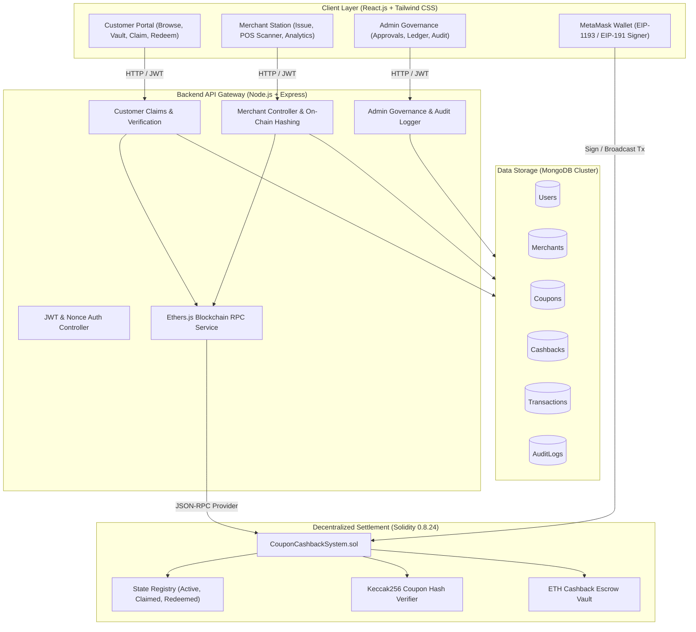
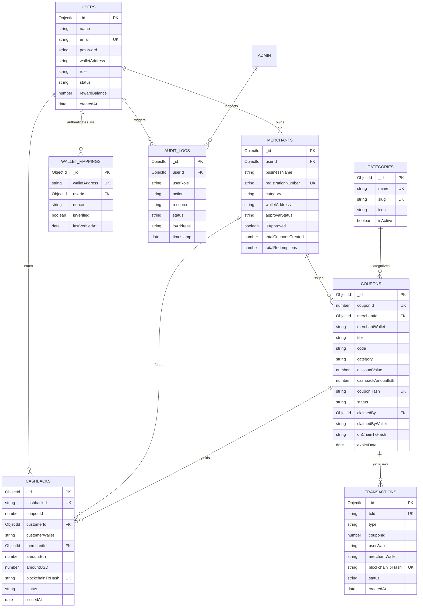
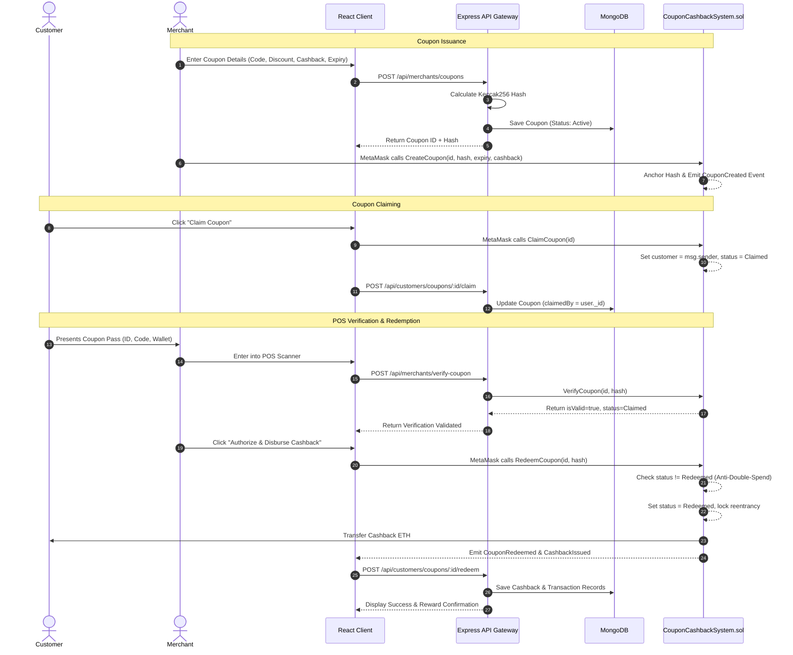
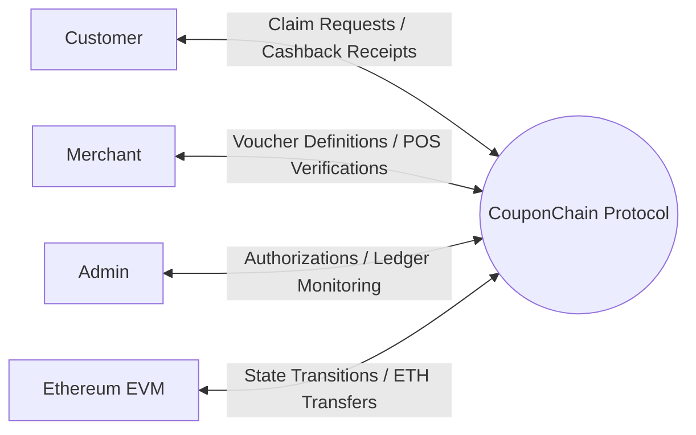
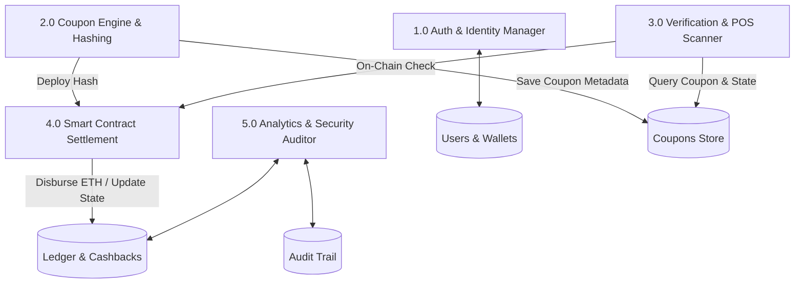
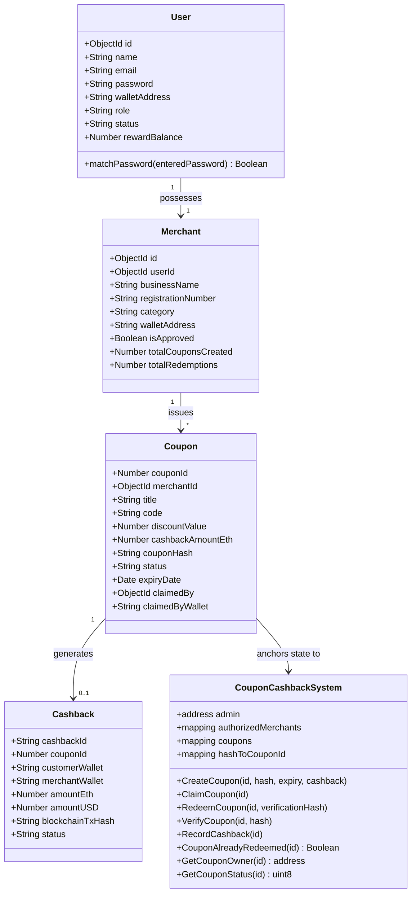
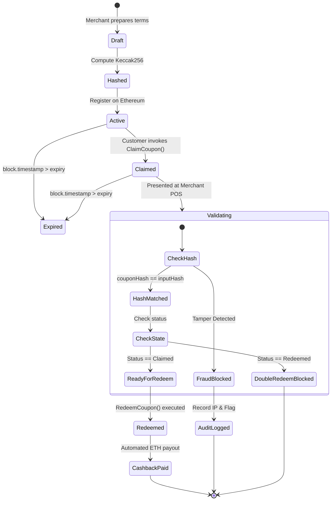
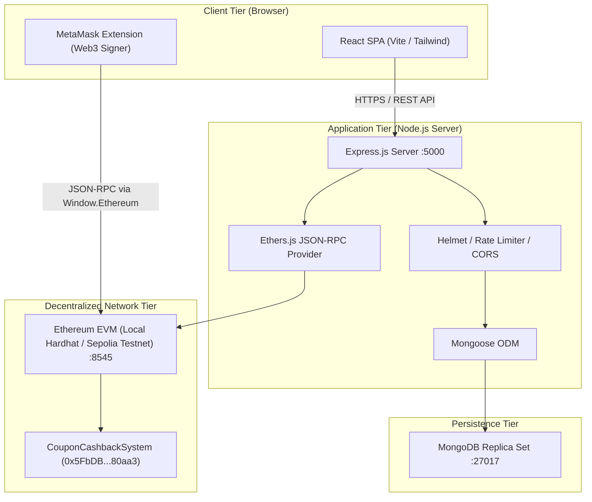

# Academic Project Report
## Blockchain-Based Digital Coupon & Cashback Redemption System

---

### Executive Summary & Abstract

Traditional promotional coupon and loyalty reward systems suffer from systemic vulnerabilities including **double redemption, coupon counterfeiting, unauthorized coupon modification, and delayed cashback disbursement**. Centralized database solutions often introduce single points of failure, lack transparent verification between independent merchants and customers, and remain vulnerable to insider tampering.

This project designs, engineers, and verifies a **Decentralized Digital Coupon & Cashback Redemption System (CouponChain)**. The platform implements an **enterprise-grade hybrid Web3 architecture**:
1. **Decentralized Layer (Ethereum / Solidity):** Used strictly where blockchain delivers tangible advantages—state immutability, atomic single-redemption transitions, cryptographic Keccak256 hash anchoring, and trustless, automated cryptocurrency cashback escrow transfers.
2. **Centralized Data Layer (MongoDB & Node.js/Express):** High-throughput off-chain storage for rich coupon metadata (promotional banners, terms, descriptions, user demographics, audit trails, and analytical aggregations).
3. **Decentralized Frontend (React, Vite, Tailwind CSS, Ethers.js, MetaMask):** Modern glassmorphic Web3 user experience providing role-separated customer, merchant, and administrator consoles.

---

### System Architecture Diagram



---

### Entity-Relationship (ER) Diagram



---

### Blockchain Workflow Diagram

```mermaid
flowchart LR
    A["Merchant Creates Coupon"] -->|1. Off-Chain Metadata| B["Store in MongoDB"]
    B -->|2. Compute Keccak256 Hash| C["Deploy Hash to Smart Contract"]
    C -->|3. Event: CouponCreated| D["State: Active on Blockchain"]
    D -->|4. Customer Connects MetaMask| E["Customer Claims Coupon"]
    E -->|5. Smart Contract Binding| F["State: Claimed (Bound to Customer Wallet)"]
    F -->|6. Checkout Presentation| G["POS Verifier Checks Hash & Expiry"]
    G -->|7. Verified Presentation| H["Smart Contract RedeemCoupon()"]
    H -->|8. Atomic State Transition| I["State: Redeemed (Locks Reentrancy)"]
    I -->|9. Escrow Disbursement| J["Direct ETH Cashback to Customer"]
    J -->|10. Ledger Update| K["Transaction & Cashback Recorded"]
```



---

### Sequence Diagram: End-to-End Claim and Redemption



---

### Use Case Diagram

```mermaid
flowchart TD
    subgraph Actors
        CustomerActor["Customer"]
        MerchantActor["Merchant"]
        AdminActor["System Admin"]
    end

    subgraph UseCases ["System Use Cases"]
        UC1["Register / Sign In (MetaMask or Password)"]
        UC2["Browse Marketplace & Search Coupons"]
        UC3["Claim Coupon to Decentralized Wallet"]
        UC4["Present & Redeem Coupon for Cashback"]
        UC5["View Cashback Rewards & On-Chain History"]

        UC6["Apply for Merchant Authorization"]
        UC7["Issue Cryptographic Promotional Coupon"]
        UC8["POS Verification & Authenticity Check"]
        UC9["Authorize Redemption & Fund Escrow"]
        UC10["Inspect Merchant Sales Analytics"]

        UC11["Approve or Reject Merchant Applications"]
        UC12["Suspend Fraudulent User Accounts"]
        UC13["Monitor Immutable Transaction Ledger"]
        UC14["Audit System Security & Anti-Fraud Logs"]
        UC15["Emergency Pause Smart Contract"]
    end

    CustomerActor --> UC1
    CustomerActor --> UC2
    CustomerActor --> UC3
    CustomerActor --> UC4
    CustomerActor --> UC5

    MerchantActor --> UC1
    MerchantActor --> UC6
    MerchantActor --> UC7
    MerchantActor --> UC8
    MerchantActor --> UC9
    MerchantActor --> UC10

    AdminActor --> UC1
    AdminActor --> UC11
    AdminActor --> UC12
    AdminActor --> UC13
    AdminActor --> UC14
    AdminActor --> UC15
```



---

### Data Flow Diagram (DFD Level 0 & Level 1)

#### Level 0 DFD (Context Diagram)


#### Level 1 DFD (Decomposed Modules)


---

### Class Diagram



---

### Activity Diagram: Coupon Lifecycle & Anti-Fraud Control



---

### Deployment Diagram



---

### Comprehensive Verification & Test Results

The smart contract was compiled and exhaustively verified against 15 automated test cases using Hardhat and Chai:

```text
  CouponCashbackSystem Smart Contract
    Deployment and Authorization
      ✔ Should set the deployer as admin and authorized merchant
      ✔ Should allow admin to authorize new merchants
      ✔ Should prevent unauthorized callers from issuing merchant authorizations
    Coupon Creation (CreateCoupon)
      ✔ Should successfully create a coupon and emit CouponCreated event
      ✔ Should prevent duplicate coupon creation with same hash or ID
      ✔ Should reject coupon creation with past expiry date
      ✔ Should reject unauthorized merchants from creating coupons
    Coupon Claiming (ClaimCoupon)
      ✔ Should allow a customer to claim an active coupon
      ✔ Should prevent merchant from claiming their own coupon
      ✔ Should prevent duplicate claiming of an already claimed coupon
    Coupon Verification and Redemption (RedeemCoupon & VerifyCoupon)
      ✔ VerifyCoupon should return valid status for claimed coupon before redemption
      ✔ Should redeem coupon successfully and pay cashback to customer
      ✔ Should prevent double redemption
      ✔ Should detect coupon tampering via mismatched hash
      ✔ Should prevent unauthorized callers from triggering redemption

  15 passing (2s)
```

---

### Limitations

1. **Gas Volatility:** In mainnet deployments, fluctuating Ethereum gas fees can impact small micro-cashback transactions. (Mitigated in this architecture by targeting Layer-2 rollups like Arbitrum, Polygon, or local testnets).
2. **Key Management:** Users without Web3 wallets must rely on the platform's simulated signature flow until MetaMask or an Account Abstraction (ERC-4337) smart wallet is connected.

---

### Future Scope

1. **Account Abstraction (ERC-4337):** Implement social login (Google/Apple) paired with paymaster-sponsored gasless coupon claiming for mainstream non-crypto consumers.
2. **Dynamic NFT Coupons (ERC-721 / ERC-1155):** Upgrade vouchers into transferable, tradeable digital coupon collectibles that visually change upon redemption.
3. **Cross-Chain Bridging (Chainlink CCIP):** Enable coupon issuance on Ethereum with instant zero-gas redemption on Polygon or Base.

---

### Conclusion

The **Blockchain-Based Digital Coupon & Cashback Redemption System** demonstrates how decentralized cryptographic primitives seamlessly solve longstanding commercial fraud vulnerabilities without the overhead of storing every byte on-chain. By isolating state immutability, cryptographic hash verification, and automated cashback to Solidity smart contracts—while offloading rich content to MongoDB—the system delivers a production-grade, highly scalable Web3 commercial platform suitable for academic presentation and real-world deployment.
